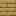
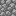
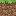

*This project has been created as part of the 42 curriculum by cpohl, craabe.*

# Cub3D / Chris3D
 

## Description
Reminiscent of old Windows screensavers and gaming classics such as Doom and Wolfenstein, this program allows the player to navigate a 3D environment with a user-determined map as well as user-determined wall textures and colors for floor and ceiling. 
Pedagogically speaking, this project is an exercise in raycasting, text parsing and usage of the MLX package. 
The project folder contains two versions of the game:
### Mandatory Version – Features:
- .cub file parsing for wall textures, floor and ceiling colors and the map
- navigatable 3D environment
- movable player camera (orthagonal and diagonal)
- rotatable player camera (one axis)
- simple wall collision
- movable game window (not resizable)
- window termination via ESC key or OS window closing button
### Bonus Version – Additional Features:
- sophisticated wall collision (sliding along)
- a togglable minimap, showing player location within map

The program constructs the game world according to user-defined settings passed via .cub file. A .cub file contains: 
- paths to the wall textures
- RGB codes for both floor and ceiling colors
- a map representation containing specific characters:
    - *1* = wall
	- *0* = floor
	- *N* = player starting position, facing north
	- *S* = player starting position, facing south
	- *W* = player starting position, facing west
	- *E* = player starting position, facing east

Invalid or inaccessable texture file paths and invalid color codes will be rejected by the program. 
The map is not allowed to contain any other characters and must have exactly one player starting position marker. Furthermore, the map has to be enclosed by walls with no open boundaries ("round" corners are legal; see *./maps/valid/cornerless.cub*). The map can't have empty lines, so vertically separate rooms are invalid. Horizontally separate rooms are legal, though only the one containing the player starting position marker can be traversed in-game. 
In case of violation of any of these requirements, the program returns an error message in the terminal.

## Instructions
### Compilation
1. Copy the repository onto your drive:

       git clone [REPO LINK] chris3D

2. Enter the newly created directory:

       cd chris3D

3. Execute the make command to compile the program 
	Note: upton first-time compilation, the MLX42 library is downloaded into the respective folder.

    3.1. Mandatory version:

       make

    3.2. Bonus version:

       make bonus
	

4. Pick one of the .cub files in the *./maps/* directory or create your own

5. Execute the program on project folder root level using the chosen .cub file via:
    
        ./cub3D [.CUB FILE PATH]

    5.1. Example for a valid .cub file:
    
        ./cub3D maps/valid/standard.cub

6. Interact with the game window (for valid .cub files) or observe the terminal error message (for invalid .cub files)

### In-game controls
- use **WASD keys** to move the camera around
- use the **left and right arrow keys** to rotate the camera
- press the **ESC key** or the OS window **closing button** (usually *x* in window corner) to close the game
- BONUS ONLY: use the **TAB key** to toggle the minimap

### Valgrind Memory Testing
Use the command:

    valgrind --suppressions=./ignore.supp -s --show-leak-kinds=all ./cub3D [.CUB FILE PATH]

Explanation:

- *--suppressions=./ignore.supp* 
Directs Valgrind to file containing info on what to suppress during error reports (see section *Suppression file for Valgrind* for in-depth information).

- *-s* 
Makes Valgrind list detected errors and suppression counts (for confirmation on what was suppressed).

- *--show-leak-kinds=all* 
Makes Valgrind show all detected categories of leaks.

## Resources
- We chose to utilize the [MLX42 graphics library](https://github.com/codam-coding-college/MLX42) for all graphical aspects of the game (window creation, background color presentation, texture rendering, and raycasting). 
- We used [Valgrind](https://valgrind.org/) for memory leak testing. User testing is encouraged to be undertaken using this tool and the command detailed above. Further information can be found in the next section. 
- Files from the video game [Minecraft](https://www.minecraft.net/en-us) were utilized for the standard wall textures.
- [Google Gemini](https://gemini.google.com/app) was used to maintain a structural overview during creation of this project and to handle simple chores, such as generating lists for function declarations (for the headers). Gemini was strictly instructed to provide no completed lines of code and instead to guide through the project by elaborating on what specific parts of the logic are supposed to do. In the same restricted manner, it helped with debugging. All code in this project is self-written.

## Suppression file for Valgrind
The suppression file serves as an instruction for Valgrind to ignore detected errors caused by therein defined sources. We set this up so that errors not stemming from our own code are not displayed during the Valgrind report as we have no means to handle issues that are not caused by our own logic. Depending on the usage environment (especially OS and drivers), these statements might not catch all "external" leak causes. 
The suppression file handles aspects of the following error origins:
- *glibc* (standard C library for Linux)
- *llvm* (internal shader compilation)
- *driver_anonymous* (proprietary graphics drivers)
- *mlx* (MLX42 graphics library)

## Scrapped feature ideas
These feature ideas were considered but discarded:
- bloody screen filter at contact with cactus wall
- pain sound at contact with cactus wall
- toggle between mandatory and bonus game versions while in-game

We chose not to implement the following optional bonus features from the project assignment:
- usable doors
- animated NPC sprites
- camera rotation via mouse
